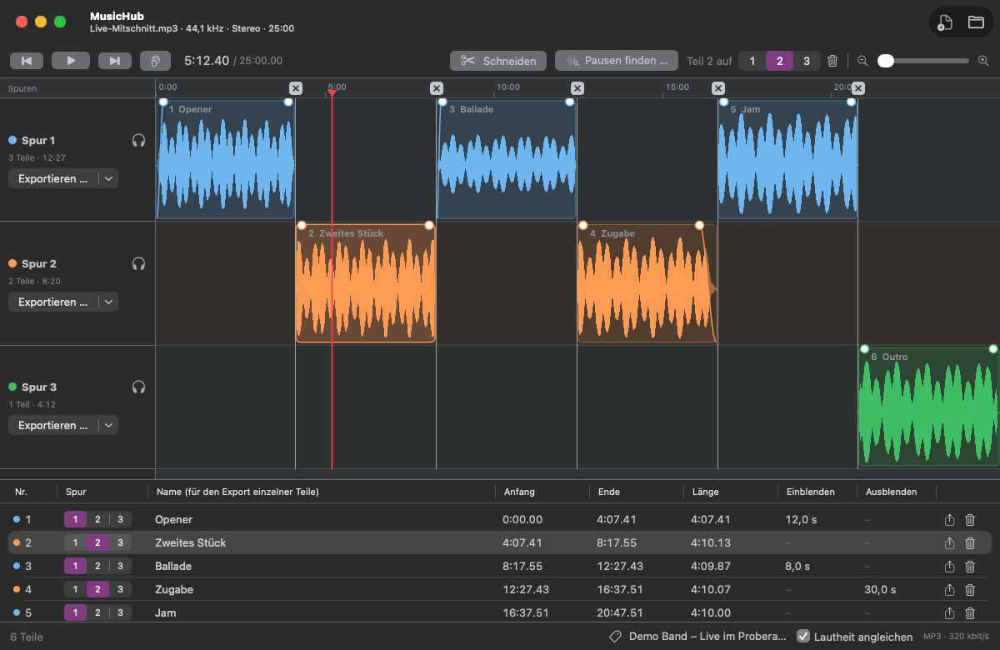

# MusicHub

A native macOS app (SwiftUI + AppKit) for cutting long audio files – live recordings, DJ sets, radio shows – and exporting the parts as MP3. It finds the pauses between pieces, reads and writes cue sheets, and joins recordings that a recorder split into several files. Cut parts are placed on three tracks, and every track is exported on its own, so nothing has to be deleted just to export a few parts. Runs entirely locally – no Xcode, no Apple developer certificate.



<sub>Sample recording generated for the screenshot, cut with **Pausen finden**. The app's interface is in German; labels are quoted below with their English meaning.</sub>

## Installation

MusicHub is part of [StudioHub](../README.md) and is built from that repository.

**Requirements:** macOS 15 or later, the Command Line Tools (`xcode-select --install`) and LAME from Homebrew for building.

```bash
git clone https://github.com/marionitschke/studiohub.git
cd studiohub
brew install lame
./build.sh music --install
```

The app is then located at `/Applications/StudioHub/MusicHub.app`. LAME's static library is linked into the app, so the finished app does not need Homebrew. Because it is built on your Mac and signed ad hoc, it launches without a Gatekeeper prompt.

- **Update:** `git pull && ./build.sh music --install`
- **Uninstall:** `rm -rf /Applications/StudioHub/MusicHub.app ~/Library/Application\ Support/MusicHub`

## Features

- **Opens** MP3, M4A/AAC, ALAC, FLAC, WAV, AIFF, OGG Vorbis, Opus and the audio of MP4/MOV videos – everything macOS can decode (not WMA). Long files load quickly: a 25-minute MP3 takes about half a second.
- **Joined recordings:** several files opened or dropped together become one recording, in the order of their names (`REC2` before `REC10`); **Anhängen** (append) in the toolbar adds files at the end later. Useful for recorders that split long recordings. The files need the same sample rate and channel count; the timeline marks where each file begins.
- **Zuletzt geöffnet** (recently opened) in the File menu and on the start screen, joined recordings included.
- **Exports** always as MP3 with 320 kbit/s (LAME), with ID3 tags and a LAME tag for gapless playback. Mono stays mono, 5.1 is mixed down to stereo, unusual sample rates are converted to 44.1 kHz.
- **One timeline** with a time ruler, three tracks and a scroll bar. Zoom with a trackpad pinch, ⌥ + scroll wheel, the slider or ⌘+ / ⌘−.
- **Schneiden** (cut) splits the part at the playhead. Drag a cut to move it; the × above it in the ruler removes it. For fine adjustments, `,` and `.` move the cut closest to the playhead by 10 ms (with ⇧ by 100 ms); the cut under the playhead is highlighted.
- **Pausen finden** (find pauses) looks for quiet stretches between pieces and proposes a cut in the middle of each – dashed in the timeline until **Schnitte setzen** (set cuts). Two sliders set how quiet (RMS averaged over about 100 ms, so room noise counts as quiet) and how long a pause has to be; a single clap or cough does not split a pause.
- **Übergang vorhören** (preview transition, V or the ear button) plays 2 s before to 2 s after the cut closest to the playhead and then returns to the cut. With a track on solo, it plays the join exactly as that track will be exported.
- **Tracks:** a new file is one part on **Spur 1** (track 1). Drag a part up or down onto another track, press 1, 2 or 3, or use the track picker in the parts list.
- **Deleting parts:** ⌫, the trash button in the parts list or next to the track picker, or **Teil löschen** (delete part) in the **Schnitt** menu. A deleted part stays in the timeline as a grey, dashed outline but is not exported and is skipped in playback. Choosing a track for it (1, 2, 3, the track picker or dragging it onto a lane) or the restore button brings it back.
- **Export per track:** the **Exportieren …** (export) button next to each track saves all of the track's parts joined into one MP3, with an ID3 chapter per part (shown by podcast apps, VLC and other FFmpeg-based players; Apple Music and QuickTime ignore chapters in MP3s). Its arrow offers **mit Cue-Datei** (with a cue sheet next to the MP3) and **Teile einzeln exportieren** (export parts individually): every part as its own MP3, named `01 Name.mp3`, or `<file> – Teil 01.mp3` (part 01) if the part has no name. The button at the end of a row in the parts list exports just that part.
- **Cue sheets:** **Cue-Datei laden …** (load cue sheet) in the File menu, or dropping a `.cue` onto the window, turns its tracks into cuts with names. A cue sheet with the same name next to the opened file is offered in the footer. Opening a cue sheet without a recording opens the audio files it names; if they have remembered cuts, those stay and the cue sheet is offered in the footer instead.
- **Tags** (footer): artist, album and cover of the exported files. They start with the tags of the source file; a cover can be any image (other formats than JPEG/PNG and images larger than 1400 px are converted).
- **Lautheit angleichen** (match loudness, footer): every exported file is brought to −14 LUFS (integrated loudness after ITU-R BS.1770, the level Spotify and YouTube play music at). Quiet recordings are raised at most until their peak reaches −1 dBFS. The audio is read twice, so the export takes a little longer.
- **Fades:** drag the round handle at a top corner of a part inwards for **Einblenden** (fade in) or **Ausblenden** (fade out). The fades follow a soft S-curve and are heard during playback and in the export. Where the export jumps from one part to a later one, a 6 ms fade prevents clicks.
- **Playback** plays all tracks (without deleted parts); the headphones button of a track plays only that track, exactly as it will be exported.
- **Remembered per recording:** cuts, tracks, deleted parts, names, fades and changed tags are stored in `~/Library/Application Support/MusicHub/` and come back when the same file (or the same set of joined files) is opened again. Every change can be undone (⌘Z).
- **Safety:** the source files are never overwritten. An MP3 is written under a hidden temporary name and only moved into place when complete; an existing file with the same name goes to the Trash (after asking, also for a cue sheet next to it). Cancelling, an error or a full disk leaves nothing behind.

## Usage

| Action | Shortcut |
| --- | --- |
| Play / pause | Space |
| Cut at the playhead | S or ⌘B |
| Move the closest cut by 10 ms / 100 ms | `,` `.` / ⇧`,` ⇧`.` |
| Preview the transition at the closest cut | V |
| Put the part at the playhead on track 1, 2 or 3 (restores a deleted part) | 1 / 2 / 3 |
| Delete the part at the playhead | ⌫ |
| 1 s back / forward | ← / → |
| 10 s back / forward | ⇧← / ⇧→ |
| Previous / next cut | ⌥← / ⌥→ |
| Start / end | Home / End |
| Zoom in / out / whole file | ⌘+ / ⌘− / ⌘0 |
| Export track 1, 2 or 3 | ⌘1 / ⌘2 / ⌘3 |
| Export the parts of track 1, 2 or 3 individually | ⌥⌘1 / ⌥⌘2 / ⌥⌘3 |
| Open a file (several are joined) | ⌘O (or drop them onto the window) |
| Undo / redo | ⌘Z / ⇧⌘Z |

The single keys do nothing while a part name is being typed.

## Building

Only the Command Line Tools and Homebrew's LAME are needed, no Xcode:

```bash
./build.sh            # build/MusicHub.app
./build.sh --install  # also installs it into /Applications/StudioHub
./build.sh --icon     # redraws the app icon (scripts/make-icon.swift → Resources/AppIcon.icns)
scripts/check.sh      # checks the edit model, fades, cue sheets, pause finder, loudness, waveform and MP3 export in temporary folders
```

## Structure

| Path | Contents |
| --- | --- |
| `Sources/MusicHub/Models.swift` | Parts, tracks, deleted parts, cuts and fades (`EditList`) |
| `Sources/MusicHub/Audio.swift` | Recordings of one or more files, parallel decoding, waveform peaks, source tags |
| `Sources/MusicHub/Analysis.swift` | Pause finder and loudness meter (ITU-R BS.1770) |
| `Sources/MusicHub/Cue.swift` | Reading and writing cue sheets |
| `Sources/MusicHub/MP3.swift` | ID3 tags with chapters, cover images, export errors |
| `Sources/MusicHub/Export.swift` | Export: pieces with fades, loudness, temporary file, moving into place |
| `Sources/MusicHub/Player.swift` | Playback of the whole recording or one track, across files |
| `Sources/MusicHub/EditStore.swift` | Remembered edits and tags per recording |
| `Sources/MusicHub/AppModel.swift` | State, undo, background work |
| `Sources/MusicHub/Timeline.swift` | The timeline (AppKit view) |
| `Sources/MusicHub/ContentView.swift` | Interface around it |
| `../shared/` | Shared with the other StudioHub apps: LAME encoder and its module map, the StudioHub menu, the Darcula look, build steps |
| `Tests/Checks.swift` | Checks |

## License note

MP3 encoding uses [LAME](https://lame.sourceforge.io) (LGPL-2.0-or-later), linked statically from Homebrew.
