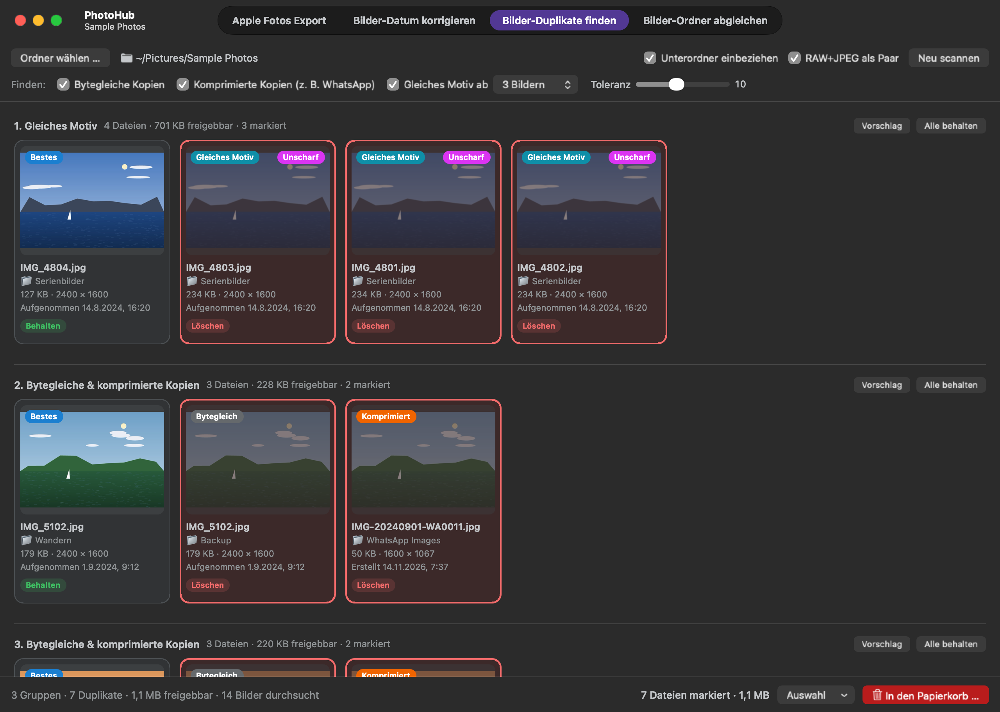

# PhotoHub

A native macOS app that finds duplicate photos in a folder and moves them to the Trash once you have reviewed them (**Bilder-Duplikate finden**, "find duplicate images"). It also copies Apple Photos exports into a year/month structure (**Apple Fotos Export**), fixes the file dates of photos and videos based on their capture time and optionally sorts them into month folders (**Bilder-Datum korrigieren**, "fix image dates"), and adds the photos and videos missing from one folder compared to another (**Bilder-Ordner abgleichen**, "sync image folders"). Runs entirely locally – no internet, no Xcode, no Apple developer certificate.



<sub>The screenshot shows artificially generated sample images only. The app's interface is in German; labels are quoted below with their English meaning.</sub>

## Installation

PhotoHub is part of [StudioHub](../README.md) and is built from that repository.

**Requirements:** macOS 13 or later and the Command Line Tools (`xcode-select --install`).

```bash
git clone https://github.com/marionitschke/studiohub.git
cd studiohub
./build.sh photo --install
```

The app is then located at `/Applications/StudioHub/PhotoHub.app`. Because it is built on your Mac and signed ad hoc, it launches without a Gatekeeper prompt. The first time it accesses protected folders (Desktop, Documents, iCloud Drive, external drives), macOS asks for permission once.

- **Update:** `git pull && ./build.sh photo --install`
- **Uninstall:** `rm -rf /Applications/StudioHub/PhotoHub.app ~/Library/Caches/local.photohub && defaults delete local.photohub`

## Usage

The title bar switches between **Apple Fotos Export**, **Bilder-Datum korrigieren**, **Bilder-Duplikate finden** and **Bilder-Ordner abgleichen** (⌘1 to ⌘4).

### Apple Fotos Export (Apple Photos export)

1. Choose **Export aus Fotos** (export from Photos) – the folder with day folders such as "1. August 2026" – and the **Ziel** (destination), e.g. your photo backup.
2. The preview shows, for each day folder, where it goes (`2026/08`), how many files are copied and renamed, and what is already in the destination.
3. **Kopieren …** (copy) copies the files; the export stays unchanged. **Rückgängig** (undo) moves the copies to the Trash, and **Ziel auf Duplikate prüfen** (check destination for duplicates) then switches to the duplicate search.

Since the export is kept, you can start over at any time or continue after an interruption: anything already in the destination is detected and skipped.

With **Verschieben statt kopieren** (move instead of copy) the files are moved out of the export instead, and emptied day folders disappear. Files already in the destination stay in the export. **Rückgängig** moves everything back.

### Bilder-Datum korrigieren (fix image dates)

1. Choose a **Ordner** (folder) or drag one into the window, then click **Prüfen** (check).
2. The list shows every file whose "created", "modified" or "added" date does not match its capture time – mismatches in orange.
3. **Datum korrigieren …** (fix dates) sets all three to the capture time; **Rückgängig** restores the old dates.
4. **In Monatsordner sortieren …** (sort into month folders) moves the photos and videos into subfolders `01` to `12` by capture month – the "Monatsordner" column shows where each file goes. If they span several years, the year comes first (`2025/12`, `2026/01`). With **Unterordner einbeziehen** (include subfolders) every subfolder gets its own month folders. **Rückgängig** moves everything back.

A large folder with pictures from January to October thus becomes the folders `01` to `10`. Pictures added later go into the existing month folders next time.

Prefer a copy first? Choose a destination under **Kopien nach** (copies to): the button then reads **In Monatsordner kopieren …** (copy into month folders), the original stays unchanged, and the destination gets the same subfolders as the original, each with month folders (`destination/Urlaub/07`). Anything already there is skipped; **Rückgängig** moves the copies to the Trash. **Kein Ziel** (no destination) switches back to moving within the folder itself.

### Bilder-Duplikate finden (find duplicate images)

1. **Ordner wählen …** (choose folder) or drag a folder into the window.
2. Under **Finden** (find), select what to look for and click **Scannen** (scan).
3. Review the suggestions: **clicking** a tile toggles between *Behalten* (keep) and *Löschen* (delete), **double-clicking** opens the photo, and **right-clicking** offers e.g. "mark all duplicates in this folder".
4. **In den Papierkorb …** (move to Trash) moves the marked files to the Trash; **Rückgängig** brings them back.

Options and tolerance can be changed after the scan; the groups are recalculated immediately.

### Bilder-Ordner abgleichen (sync image folders)

1. Choose the **Quelle (A)** (source) or drag it into the window, then folder **B**, which is to be completed.
2. The list shows every photo and video from A that is missing in B, and where it goes: into the same subfolder as in A.
3. **Nach B verschieben …** (move to B) moves these files; **Rückgängig** moves them back to A.

Afterwards, A only contains what also exists in B.

## How it works

| Option | Finds | Marks |
|---|---|---|
| **Bytegleiche Kopien** (byte-identical copies) | exactly identical files | the copies |
| **Komprimierte Kopien** (compressed copies) | the same photo in lower quality, e.g. shared via WhatsApp | the lower-quality version |
| **Gleiches Motiv ab N Bildern** (same motif from N images) | different shots with the same composition, e.g. burst shots | all but the best |

- **Byte-identical:** files of equal size are compared via SHA-256.
- **Image fingerprint:** every image is reduced to 9 × 9 cells of average brightness. The fingerprint barely changes with downscaling or compression, but clearly changes when the composition changes – head on the left and head on the right are two different motifs.
- **Copy or separate shot:** for nearly identical fingerprints, quality decides. Lower resolution or a much smaller file → compressed copy; equal quality → separate shot of the same motif. At equal resolution, sharpness counts before file size – a shaky, noisy burst shot is often the largest file but is not treated as the original.
- **Toleranz** (tolerance, "same motif" only, default 10): low = nearly identical composition, high = slightly shifted shots too, but more false positives.
- **Best file:** highest resolution, largest file, no "copy" in the name, oldest original. For "same motif" the shot itself counts: with people, the winner is the photo where nobody has their eyes closed, that is not blurry and has the best face quality (Apple Vision, on device); without people, the sharpest shot if it is clearly sharper. Sharpness is measured in the sharpest image areas, i.e. usually the subject in focus. The badges **"Augen zu"** (eyes closed) and **"Unscharf"** (blurry) show why a shot is not the best.
- **Sidecar files:** Live Photo videos (`.MOV`), `.AAE` edits and `.XMP` files with the same name move to the Trash together with the photo and come back with "undo". If the assignment is ambiguous, they are left untouched.
- **RAW+JPEG als Paar** (RAW+JPEG as a pair, default: on): RAW and JPEG with the same name in the same folder count as one photo – the JPEG is not marked as a compressed copy and moves with the RAW.
- **Scan cache:** checksums, fingerprints, sharpness and face checks are stored per file (`~/Library/Caches/local.photohub`). A new scan only reads new or changed photos (different size or modification date), so an interrupted scan also resumes next time. **Ablage → Scan-Cache leeren** (File → clear scan cache) forces a complete re-analysis.
- **Apple Photos export:** files from day folders with a German date ("1. August 2026", also "3. Maerz 2025") are copied – or optionally moved – to `destination/YYYY/MM`; other folders and subfolders are ignored. If the destination already contains a file with the same name and content (size, start and end of the file), it is skipped; with different content the copy is stored as `Name_1` – Live Photos (HEIC + MOV) together. On APFS the copies are clones: instant and taking no extra space until one side changes. Moving on the same volume is just a rename; to another volume, files are copied and verified first, then the original is removed. For another volume, free space is checked beforehand. Optionally, Finder shows the capture time from EXIF or video metadata, including time zone, as "created", "modified" and "added" for the files in the destination.
- **Fixing image dates:** the same capture-time logic as the Apple Photos export, applied to photos and videos in place. Only the three Finder dates are changed, never the image data. Files without a capture time stay as they are; files stored only in iCloud are not downloaded and are skipped.
- **Month folders:** files are sorted by capture time, files without one (e.g. WhatsApp images) by their modification date. Live Photos, RAW+JPEG and `.AAE`/`.XMP` files with the same name stay together. Month only (`03`) as long as no folder ends up with pictures from two years – including existing month folders; otherwise year/month. Every folder is sorted on its own; anything already in month folders `01` to `12` stays where it is. Other files and files only in iCloud stay in place. If a name is already taken in the month folder, the file is added as `Name_1`. "Created", "modified" and "added" are preserved. Copies into a destination are clones on APFS; if a file with the same name and content (size, start and end) is already there, it is not copied again. The destination must not be inside the folder or vice versa; for another volume, free space is checked beforehand.
- **Syncing image folders:** a file from A is missing in B if no file with the same content exists anywhere in B (SHA-256 of the whole file; name and subfolder don't matter). Photos, videos and `.AAE`/`.XMP` files are compared; an `.AAE`/`.XMP` file only counts as present in B under its own name, since the same edit applied to two photos gives identical files. Other files stay in A. If the name in B is already taken by another file, it is added as `Name_1` – Live Photos together. If the same file exists several times in A, only one moves. "Created", "modified" and "added" are preserved. To another volume, files are copied and verified first, then the original in A is removed. Files stored only in iCloud are neither downloaded nor compared.
- **Safety:** PhotoHub never deletes permanently. Apple Photos libraries and hidden files are skipped. Review "same motif" matches before deleting. Right before moving files to the Trash, PhotoHub checks them again: files changed since the scan, and groups whose kept file has disappeared meanwhile, are skipped. Quitting while files are being copied or moved stops after the current file, so no half-copied file is left behind.
