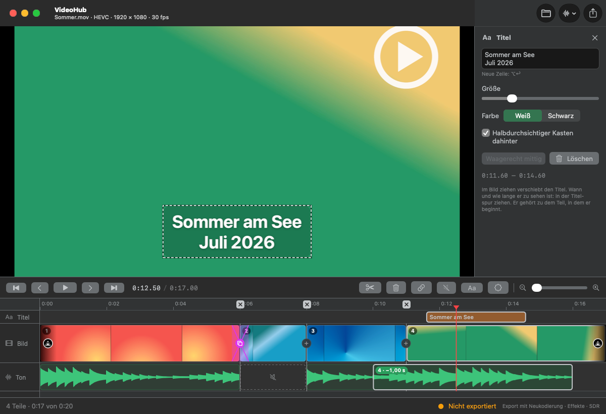

# VideoHub

A native macOS app (SwiftUI + AppKit) for trimming videos from the iPhone and other MOV and MP4 files: cut, delete and reorder parts, shift or mute their sound, add transitions, titles and a logo. Without effects the result is exported without re-encoding – in original quality, HDR and Dolby Vision included; with effects it is encoded anew as H.264 or HEVC. The sound can be exported on its own. One video per window, nothing is stored: the edit lives until the app quits. Runs entirely locally – no Xcode, no Apple developer certificate.



<sub>Sample footage generated for the screenshot. The app's interface is in German; labels are quoted below with their English meaning.</sub>

## Installation

VideoHub is part of [StudioHub](../README.md) and is built from that repository.

**Requirements:** macOS 15 or later, the Command Line Tools (`xcode-select --install`) and LAME from Homebrew for building.

```bash
git clone https://github.com/marionitschke/studiohub.git
cd studiohub
brew install lame
./build.sh video --install
```

The app is then located at `/Applications/StudioHub/VideoHub.app`. LAME's static library is linked into the app, so the finished app does not need Homebrew. Because it is built on your Mac and signed ad hoc, it launches without a Gatekeeper prompt.

- **Update:** `git pull && ./build.sh video --install`
- **Uninstall:** `rm -rf /Applications/StudioHub/VideoHub.app && defaults delete local.videohub`

## Features

- **Opens** MOV, MP4 and M4V – whatever macOS plays itself: H.264, HEVC (also HDR and Dolby Vision from the iPhone), ProRes, AV1 on Macs that decode it. Not MKV, WebM or AVI. Open with ⌘O, by dropping a file onto the window or onto the Dock icon.
- **One timeline** with a time ruler, a picture lane with thumbnails, a sound lane with the waveform and a scroll bar. Zoom with a trackpad pinch, ⌥ + scroll wheel, the slider or ⌘+ / ⌘−; ⌘0 shows the whole video.
- **Schneiden** (cut, S or ⌘B) splits the part at the playhead. Positions snap to whole frames.
- **Moving a cut:** drag it in the timeline, or press `,` / `.` to move the cut closest to the playhead by one frame (with ⇧ by ten). The × above a cut in the ruler removes it. While dragging, the preview shows the frame right after the cut.
- **Trimming:** drag the start or end of a part. A part can also be lengthened again into material that was cut away; the preview shows its first or last frame while dragging.
- **Teil löschen** (delete part, ⌫) removes the part at the playhead. **Alle Schnitte entfernen** (remove all cuts, in the **Schnitt** menu) goes back to the whole video.
- **Reordering:** drag a part by its picture to another place; a blue line shows where it will go.
- **Ton lösen** (detach sound, L) frees the sound of the part at the playhead from its picture. It then lies on top of the sound lane with a badge (part number and shift, e.g. `4 · −1,00 s`): drag it sideways to make it start earlier or later, drag its edges to shorten it or let it run on into the neighbouring parts. `⌥,` / `⌥.` shift it by one frame (with ⇧ by ten) – handy when sound and picture are slightly out of sync. Where a detached sound overlaps another part's sound it replaces it (nothing is mixed); where it has moved away from its own picture, that picture is silent. It stays with its part when the part is moved or trimmed, and a cut splits it so that nothing sounds different. **Ton anlegen** (attach sound, L) puts the original sound back under the picture.
- **Stumm** (mute, M) silences the part at the playhead; **Ton an** (sound on) gives it back. To silence just a moment – a cough, a gust of wind – cut before and after it and mute the part in between; the picture runs on without a jump.
- **Übergänge** (transitions): each cut has a round button in the picture lane (a + while it has none) that offers **Überblendung** (cross-dissolve) and **Abblende über Schwarz** (dip to black); the buttons at the start and the end of the video fade in from black and out to black. A transition lasts 0.25, 0.5 (default), 1 or 2 s and takes at most half of a part. A cross-dissolve runs centred on the cut and uses frames that were cut away on both sides; where there are too few, it is shortened or shifted, and the menu says so. Dips and fades take the sound along; at a cross-dissolve the sound changes at the cut as before. The **Effekte** (effects) menu sets a transition at the cut closest to the playhead.
- **Titel** (titles, T) adds a title at the playhead, three seconds long. It appears in the title lane above the picture: drag it to change when it shows, drag its edges to change how long. A double-click on an empty spot in the lane adds one there. In the preview, drag the title to any place (it snaps to the horizontal centre). The settings on the right: text with several lines (⌥↩ for a new line), size, white or black, an optional semi-transparent box behind it, centring. Titles are set in SF Pro bold and fade in and out briefly. A title belongs to the part it starts in and moves, trims and disappears with it. ⌫ deletes the selected title, esc ends the selection.
- **Logo** places an image (PNG, JPEG, HEIC, …) over the whole video. Drag it in the preview; size and opacity are set on the right. VideoHub keeps a copy of the image and remembers its place: in the next video one click on **Logo** puts it back – it is never added on its own.
- **Video exportieren** (export video, ⌘E) writes the edit as a new file named `<name> (gekürzt)` (trimmed), as **MP4** or **MOV**: the **Format** popup in the save dialog offers the container of the source first and then remembers the last choice. Without effects, frames and sound are copied, not re-encoded, so even long videos take seconds and lose nothing. The recording date stays, and a portrait video stays upright. A MOV from the iPhone keeps place and camera as well; exported as MP4 it keeps date and place, but not make and model (MP4 has no place for them). An MP4 keeps its title and date tags. ProRes fits only in a MOV without re-encoding, so MP4 is greyed out for it. The cuts are frame-accurate: the file keeps the frames from the preceding keyframe and an edit list that tells the player where to start. QuickTime Player, Photos and iOS honour it; a player that ignores edit lists shows a few extra frames before each cut.
- **Export with effects:** as soon as the edit has a transition, a title or a logo, the footer says **Export mit Neukodierung** (export with re-encoding) and the save dialog adds a **Codec** popup: **H.264** (plays everywhere) or **HEVC** (smaller file). The video keeps the resolution and frame rate of the source and is written in SDR (Rec. 709) – HDR from the iPhone is tone-mapped. The sound is encoded as AAC; recording date, place and orientation stay as with the plain export.
- **Ton exportieren** (export sound) saves the sound of the edit as **M4A** (AAC, 256 kbit/s), **WAV** (16 bit) or **MP3** (320 kbit/s, LAME), at the sample rate of the video and mixed down to at most two channels. The sound is decoded and encoded anew, so it is cut exactly in every program.
- **Originalton in MusicHub öffnen** (open the original sound in MusicHub) hands the video file to [MusicHub](../musichub/README.md), which cuts its sound into MP3s. The cuts made in VideoHub are not passed on.
- **Spatial Audio:** iPhone videos with Spatial Audio carry an extra APAC track next to the normal stereo track. VideoHub plays, shows and exports the stereo track; the APAC track is not part of the export.
- **Nothing is stored:** VideoHub keeps no project files (only the logo and its place, see above). Every change can be undone (⌘Z) until the app quits. **Nicht exportiert** (not exported) in the footer shows changes that have not been exported as a video yet. With such changes, closing the window keeps the app running (the Dock icon brings the window back), and quitting or opening another video asks first. Exporting only the sound does not count.
- **Safety:** the source file is never overwritten. An export is written under a hidden temporary name next to the destination and only moved into place when complete; an existing file with the same name goes to the Trash. Cancelling leaves nothing behind.

## Usage

| Action | Shortcut |
| --- | --- |
| Play / pause | Space |
| Cut at the playhead | S or ⌘B |
| Move the closest cut by one frame / ten frames | `,` `.` / ⇧`,` ⇧`.` |
| Delete the selected title or logo, else the part at the playhead | ⌫ |
| Add a title at the playhead | T |
| End the selection of a title or the logo | esc |
| Detach the sound of the part at the playhead / attach it again | L |
| Mute the part at the playhead / sound on | M |
| Shift the sound of the part at the playhead by one frame / ten frames | ⌥`,` ⌥`.` / ⇧⌥`,` ⇧⌥`.` |
| One frame back / forward | ← / → |
| One second back / forward | ⇧← / ⇧→ |
| Start of the part (pressed again: previous part) / next part | ⌥← / ⌥→ |
| Start / end | Home / End |
| Zoom in / out / whole video | ⌘+ / ⌘− / ⌘0 |
| Export the video | ⌘E |
| Open a video | ⌘O (or drop it onto the window) |
| Undo / redo | ⌘Z / ⇧⌘Z |

A click in the timeline moves the playhead; dragging in the ruler or the sound lane scrubs through the video (dragging a picture moves the part, dragging a detached sound shifts it, dragging a title changes its time). In the preview, a click selects a title or the logo and dragging moves it.

## Building

Only the Command Line Tools and Homebrew's LAME are needed, no Xcode:

```bash
./build.sh            # build/VideoHub.app
./build.sh --install  # also installs it into /Applications/StudioHub
./build.sh --icon     # redraws the app icon (scripts/make-icon.swift → Resources/AppIcon.icns)
scripts/check.sh      # checks the edit model and exports generated test videos in temporary folders
```

`scripts/check.sh` generates small test videos whose frames show their own number and whose sound beeps every second, exports them cut and reordered, and checks frame by frame that the right frames come out and that the sound stays in sync – as MOV and MP4 (also from one into the other), H.264, HEVC and ProRes, portrait and without sound, with a shifted sound, plus the sound export in all three formats. For the effects it checks the layout of transitions, how titles follow cuts, and in exported videos the brightness of fades and dips, the blend of a cross-dissolve, title and logo, the sound ramps and the SDR colour tags. `VIDEOHUB_KEEP=1 scripts/check.sh` keeps the files for a look with other tools.

## Structure

| Path | Contents |
| --- | --- |
| `Sources/VideoHub/Models.swift` | Parts in playback order, cuts, trimming, detached and muted sound, transitions, titles, logo (`EditList`), time formatting |
| `Sources/VideoHub/Effects.swift` | Where transitions run: clips on alternating tracks, blends, brightness and volume ramps |
| `Sources/VideoHub/Compositor.swift` | Custom video compositor (Core Image): dissolves, fades, titles, logo; video composition and audio mix |
| `Sources/VideoHub/Video.swift` | Opening a video, tracks and timing, building the composition, waveform peaks |
| `Sources/VideoHub/Player.swift` | Preview with two players, so that a new edit appears without a black frame; dragging titles and the logo |
| `Sources/VideoHub/Thumbnails.swift` | Thumbnails for the picture lane |
| `Sources/VideoHub/Export.swift` | Video export without re-encoding or with effects, sound export, temporary file, moving into place |
| `Sources/VideoHub/ExportPanel.swift` | MP4 or MOV and the codec: the popups in the save dialog |
| `Sources/VideoHub/AppModel.swift` | State, undo, playback, keyboard |
| `Sources/VideoHub/AppModel+Effects.swift` | Transitions, titles and logo: changes, selection, the stored logo |
| `Sources/VideoHub/Timeline.swift` | The timeline (AppKit view) |
| `Sources/VideoHub/ContentView.swift` | Interface around it |
| `../shared/` | Shared with the other StudioHub apps: LAME encoder and its module map, the StudioHub menu, the Darcula look, build steps |
| `Tests/Checks.swift` | Checks |

## License note

MP3 encoding uses [LAME](https://lame.sourceforge.io) (LGPL-2.0-or-later), linked statically from Homebrew.
